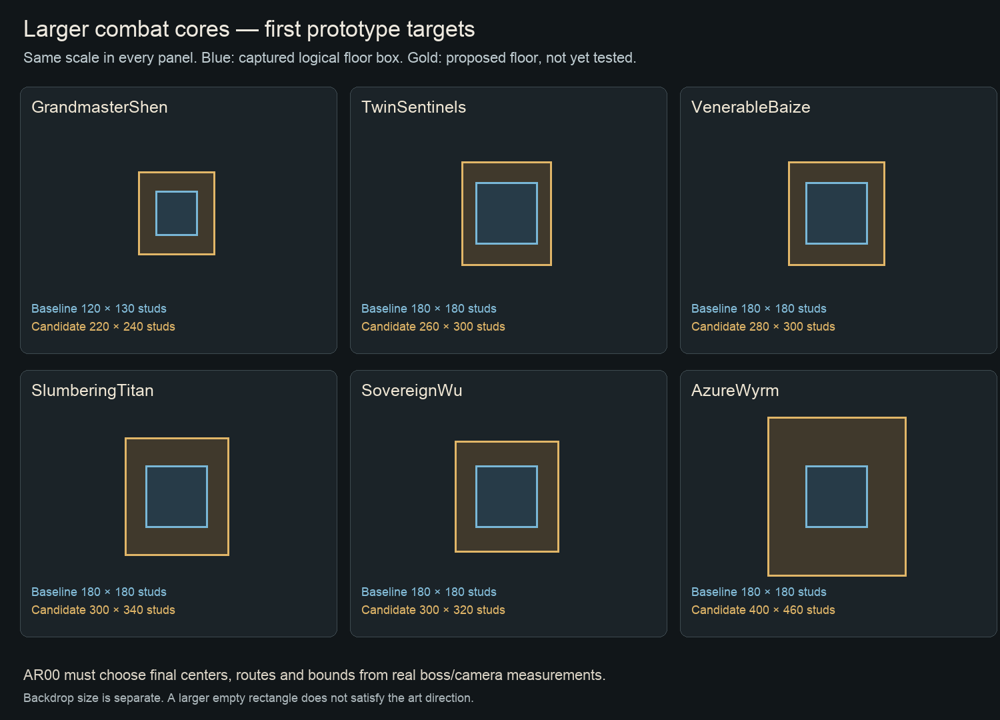

# Six larger arenas — design and implementation prompts

Updated 7 November 2026. Follow [ASSET_WORKFLOW.md](ASSET_WORKFLOW.md) for ForgeGUI reuse/generation and Blender construction. Existing boss model creation is complete per the creator. This plan changes environments and, after measurement, spatial encounter data. No arena change has been implemented by this document.

## Scope and scale

Build **larger playable arenas** plus convincing world-scale surroundings. More floor alone will repeat the current empty-pad problem. The supplied references communicate scale through long sightlines, enormous architecture/root silhouettes, sparse but purposeful foreground detail, atmospheric separation and an opponent who still reads clearly. Screenshots do not establish their exact real-world dimensions.

The baseline data comes from WorldDefinitions/BossRoster: Shen 120×130; the other five encounters use a shared 180×180 XZ box. These are logical boxes, not measurements of the full art envelope or proof that every box face is unobstructed.

| Prompt | Encounter / direction | Baseline core (studs) | First candidate core (studs) | Area change | Nominal full-length walking time* |
|---|---|---:|---:|---:|---:|
| [AR01](prompts/AR01_GRANDMASTERSHEN_ARENA.md) | GrandmasterShen — The Ashen Covenant | 120×130 | 220×240 | 3.38× | 10.7 s |
| [AR02](prompts/AR02_TWINSENTINELS_ARENA.md) | TwinSentinels — The Broken Processional Court | 180×180 | 260×300 | 2.41× | 13.4 s |
| [AR03](prompts/AR03_VENERABLEBAIZE_ARENA.md) | VenerableBaize — The Frost-Hollow Hunting Ground | 180×180 | 280×300 | 2.59× | 13.4 s |
| [AR04](prompts/AR04_SLUMBERINGTITAN_ARENA.md) | SlumberingTitan — The Cathedral Beneath the Roots | 180×180 | 300×340 | 3.15× | 15.2 s |
| [AR05](prompts/AR05_SOVEREIGNWU_ARENA.md) | SovereignWu — The Starless Mirror Court | 180×180 | 300×320 | 2.96× | 14.3 s |
| [AR06](prompts/AR06_AZUREWYRM_ARENA.md) | AzureWyrm — The Storm-Crowned Expanse | 180×180 | 400×460 | 5.68× | 20.5 s |

*Arithmetic only at the captured nominal 22.4-stud/s walk speed, without acceleration, attacks, detours or interruptions. This is a design warning/measurement aid, not a runtime benchmark. Actual re-engagement should be much shorter than end-to-end crossing. Final dimensions require the actual imported boss rigs and normal-camera combat prototype; do not silently revert to the original small footprint and declare the scale request met.

## Required preflight

Run [AR00 spatial plan and measured prototypes](prompts/AR00_SPATIAL_PLAN_AND_SCALE_PROTOTYPES.md) after [C00 asset/scale survey](prompts/C00_SURVEY_AND_ASSET_INTAKE.md). AR00 must deliver a top-down coordinate map and machine-readable old/new manifest covering regions, floors, fog gates/triggers, allowed spawn/outside/catch locations, routes, altars, secrets, terrain and scenery. Prototype two larger footprints; choose a concrete supported one.

Current dependencies make scale-in-place unsafe:

- **Baize:** a 300-deep floor centered at -1470 spans z=-1620..-1320, consuming shrine/exit space. A connected side basin or full local re-layout is needed.
- **Wu:** 320 depth at -2380 spans -2540..-2220 and consumes the forecourt/rafters/dawn terrace. Re-layout or a connected side expanse is required.
- **Wyrm:** 460 depth at -2830 spans -3060..-2600 and consumes the bastion/approach. A surveyed southern extension is a plausible starting direction, not an already tested placement.
- **Titan:** a 300-wide floor centered at x520 spans x370..670 and intrudes into the ossuary/balcony structure. Expand away from, or coherently reconnect, the compact crypt routes.
- **Twins:** widening/deepening can engulf the courtyard approach near z=-810. The side-road bend, gate and region boundary must agree.
- **Shen:** larger seating/facade and floor must still fit the Champions Hall, Victor exit, Proving Court connection and Pagoda cloud stair.

Arena bounds changes affect real gameplay. BossMotion has a fixed 12-stud XZ clamp inset, Wu retreats a fixed 35 studs, BossBodies uses fixed ±60/±50 pounce-pillar offsets, and several hazards have radii 90–240. CameraController currently acquires lock at 60 studs, breaks it at 80 and limits the follow boom to 8–16 studs; verify these against larger boss bodies and separation. Retain timing/contact authority while evaluating how these values behave in the new space. Do not multiply attack radii, speeds, damage or parry windows by the arena scale factor.

## Per-arena direction and complete prompts

### AR01 — The Ashen Covenant / GrandmasterShen

An immense roofless funerary amphitheatre, not a bright miniature training court. A broad ash-pale fighting floor sits within worn radial seating fronts and shattered arcades. One split black cenotaph with an austere empty vertical cleft dominates the far horizon, backed by pale dust-lit cloud and distant ruined bridges; it is original architecture, not a copy of a recognizable tree/gate from the references. Sparse silver reeds, buried weapon fragments and worn votive figures occupy the outer ash banks. Charcoal/basalt/old bronze against muted cold-grey ash, with tiny ember warmth and no blanket orange grading.

**Entry:** Approach through a low, dark champion arcade, then step out into the full sky and long view of the split monument; the boss is the first moving silhouette against a calmer floor. The Victor exit remains legible in the far-side composition after victory.

**Spatial work:** A wider/longer in-place bowl is the preferred pilot if it fits the Ash region; moving the facade/gate north or the tiers out requires preserving both hall encounter pockets and the Cloud Stair join near z=-2120. Survey and remap the Proving Court access too. Do not let an enlarged floor silently swallow hall mobs, fog triggers or Victor gate. Keep the arena center at floor Y=0 unless the common floor assumptions are explicitly generalized.

**Fight checks:** Shen needs an intimate exchange inside a monumental setting. Initial spawn spacing must not be half the full floor length. Test FlowingJian travel, PrayerBeads at radius 90, phase-2 BloodWave radius 90 and Skyfall/edge clamping. Do not enlarge those radii or increase movement/parry tempo merely because the floor grew. Keep central ground mostly flat, with shallow noncollision wear and perimeter detail. Validate both humanoid and Chimera camera poses.

**Create/reuse:** B01, B07, B09, B10, H01 optional.

**Copy-paste implementation:** [AR01_GRANDMASTERSHEN_ARENA.md](prompts/AR01_GRANDMASTERSHEN_ARENA.md). **Optional 2D environment concept:** [AR01_ARENA_CONCEPT.md](prompts/AR01_ARENA_CONCEPT.md).

### AR02 — The Broken Processional Court / TwinSentinels

A fallen fortified ceremonial precinct of an older stone civilization: vast broken limestone domes, tiered processional stairs, deep arcades and a partially collapsed aqueduct on cliffs. The main court is broad, level, worn pale stone with subtle wheel/foot traffic patterns and a few inlaid processional lines. Monumental empty guard plinths and reused worn statues frame the entrance and far stair. The actual fight floor remains open enough for Bull and Zhao together. Weathered ochre-grey masonry, soot and dark leafless trees; restrained ceremonial bronze. The neighboring monastery can retain its East Asian layers while this older foundation uses Romanesque/sepulchral architecture.

**Entry:** The narrow ridge pass turns before opening onto the full facade and two defended silhouettes. Large foreground masonry frames a distant dome, with another city tier far behind it. Show a plausible traversable connection to the existing monastery, not a freestanding square grey pad.

**Spatial work:** The existing arena is centered near x300,z=-930 and the side approach road passes around z=-810. A 300-deep expansion intersects that approach unless it is remapped. Fit the route, gate/trigger and outside/inside destinations together; check the monastery region width extension and actual ridge/terrain. Preserve Cloister shelter and ordinary monastery foe posts. Do not delete the entire monastery to make room.

**Fight checks:** Measure both supplied models with maul/shield/glaive extents and the duo separation rules. Test simultaneous movement, IronCharge, ThunderQuickstep, outer-corner pinning and both kill orders/enrage. Add no central pillars that split visibility or create infinite-kite refuge. Keep both bosses close enough to participate; the enlarged court must not create sequential isolated duels by accident.

**Create/reuse:** B01, B07, B09, B10, H01 optional, H04 optional.

**Copy-paste implementation:** [AR02_TWINSENTINELS_ARENA.md](prompts/AR02_TWINSENTINELS_ARENA.md). **Optional 2D environment concept:** [AR02_ARENA_CONCEPT.md](prompts/AR02_ARENA_CONCEPT.md).

### AR03 — The Frost-Hollow Hunting Ground / VenerableBaize

An ancient hunting hollow beyond the cultivated bamboo shrine: low charcoal wet slate in the central fight clearing, pale frost-grass and snow caught at its edges, a few colossal wind-bent petrified roots, limestone ribs and deep distant bamboo. Four distinct ruined frost-perch pillars grow out of the terrain/court with meaningful silhouettes; their tops and approach paths remain mechanically readable. The white beast must contrast against darker central stone, while white reed fields and silver mist expand the horizon. Sparse red ritual cloth and dark bronze bells carry the sanctuary culture into a wilder older place. No uniform lawn border around a giant tiled rectangle.

**Entry:** The visitor leaves a sheltered shrine path and passes under a ruined root/stone arch; near vegetation falls away to reveal an unexpectedly wide basin and distant frost ridges. Keep the moon-gate/ash descent exit recognizable without filling the combat clearing with stairs.

**Spatial work:** Enlarging 180 to 300 depth around current center z=-1470 would cover the shrine near z=-1328 and run into the moon-gate/descent near -1577. Do not perform that scale-in-place change. AR00 must choose either a coherent side-basin extension/relocation with a short walkable connection, or remap the surrounding shrine/exit pockets as one authored local layout. Preserve the new Foundry wing, frost steps/supports, ridge gate and the improved wall bays where they remain on the route.

**Fight checks:** Use the supplied Baize model, not a new creature. Keep BossBodies.pillars, BossArenas visible/collision geometry, AI avoidance and BossMotion pillarPerch/arc aligned to one authored layout. Current fixed ±60/±50 pillar offsets must be reviewed against the larger court and actual pounce duration; do not spread pillars to the far corners if the existing launch/landing timing becomes unreadable. Test all four pounces, chase across the expanded clearing, landing clearance and camera behind the beast. MeteorPounce currently has radius 100: evaluate telegraph/escape consequences without inflating it with arena scale.

**Create/reuse:** B01, B06, B07, B09, H03 optional.

**Copy-paste implementation:** [AR03_VENERABLEBAIZE_ARENA.md](prompts/AR03_VENERABLEBAIZE_ARENA.md). **Optional 2D environment concept:** [AR03_ARENA_CONCEPT.md](prompts/AR03_ARENA_CONCEPT.md).

### AR04 — The Cathedral Beneath the Roots / SlumberingTitan

A huge burial cathedral engulfed by a dead subterranean root system. The approach stays an intimate built crypt; the boss chamber opens into a cavern where pale petrified roots act as vast buttresses above fractured sepulchral architecture. A great split stone apse and a cold high fissure create layered depth behind the Titan. Graves/coffins and broken restraints gather at the margins; a shallow dark flooded ambulatory catches faint light outside the level central floor. Ancient limestone, mineral-white roots and umber crevices with sparse ember-bronze binding. The Titan remains the only active giant in the space, with its ankle weak points readable against calm stone.

**Entry:** Descend through the existing gallery/ossuary scale, glimpse a root silhouette from the balcony, then pass under a heavy entrance arch into a chamber much larger than the approach suggested. Use a strong single overhead shaft and peripheral warm burial lights, not a low grid of straight ceiling beams.

**Spatial work:** A 300-wide chamber exceeds the present x430..610 fight floor and intrudes into the ossuary/balcony/crossing if centered unchanged. Expand the chamber into a surveyed free cavern direction, preferably away from the small crypt route, and remap the gate/arena center/return/catch volumes together. Preserve or deliberately reconnect all descent, altar, ossuary, stepping-lid, reliquary and balcony routes. The root ceiling is mostly set dressing, never an accidental collider above the boss or camera.

**Fight checks:** Measure the completed Titan model and kneeling/head target height. Preserve safe ankle access, around-body camera paths and deathblow reach. WorldTremor radius 240 and MagmaWake radius 135 currently relate to a much smaller floor; verify that the new layout does not create a permanent safe shelf, force impossible traversal or hide shockwave heights. Keep central vertical steps out of the fight; puddle art may not change movement/grounding. Do not add damaging magma to the floor merely for atmosphere.

**Create/reuse:** H03, H04 optional, B01, B02, B05, B09.

**Copy-paste implementation:** [AR04_SLUMBERINGTITAN_ARENA.md](prompts/AR04_SLUMBERINGTITAN_ARENA.md). **Optional 2D environment concept:** [AR04_ARENA_CONCEPT.md](prompts/AR04_ARENA_CONCEPT.md).

### AR05 — The Starless Mirror Court / SovereignWu

A drowned observatory court beneath a starless indigo sky. The playable surface is a level dark stone platform under a very shallow reflective-looking water layer; submerged radial inlays and broken stone seams establish footing. Far out, thin ruined arcades and a few impossibly tall dim vertical light/rain bands make the horizon feel immense. The Oracle throne remains an elevated lore focal point on the approach, and existing distant pagodas survive as remnants rather than every structure repeating the same roof. A broken astrolabe aperture frames the Oracle from entry. Blue-black water, desaturated violet stone, tarnished gold and restrained cold reflected light; phase-two bloodflame is a readable accent, not a permanent red room.

**Entry:** The narrow eave-gallery/rafter traversal builds height and enclosure, then releases into a calm, vast-looking mirror court. Use the horizon and one celestial focal aperture to make the Oracle silhouette readable from the gate. Keep a visible return/dawn exit and a spatially believable link to the existing loft and bell.

**Spatial work:** A 320-deep floor at the current center z=-2380 overlaps the rafter/forecourt to the north and dawn terrace to the south. AR00 must enlarge/reconfigure the zone or place a connected side expanse, not simply stretch Forecourt and cover the routes. Update region/arena membership and relocation of lore/altar/portals only where planned, retaining IDs. Do not turn off authoritative boundaries to imitate an endless lake.

**Fight checks:** Use decorative shallow water over an intentional reliable floor; do not accidentally enable swimming, buoyancy, collision ripples or changed foot height. Validate Wu teleport clamp, safe destinations and retreat distance, long-range barrage resolution, gravity/ritual visibility and player separation at far edges. Current SoulSpears radius 140, ritual radius 130 and fixed 35-stud retreat must be evaluated without globally scaling damage ranges. Keep inlay and reflections low contrast enough to distinguish telegraphs and the actual crimson attacks.

**Create/reuse:** H02, B01, B06, B07, B08, H04 optional.

**Copy-paste implementation:** [AR05_SOVEREIGNWU_ARENA.md](prompts/AR05_SOVEREIGNWU_ARENA.md). **Optional 2D environment concept:** [AR05_ARENA_CONCEPT.md](prompts/AR05_ARENA_CONCEPT.md).

### AR06 — The Storm-Crowned Expanse / AzureWyrm

A wind-scoured summit of an ancient ruined city, with a vast dark slate landing shelf and storm-pale ash/frost at the outer margins. Broken domed rotundas and aqueduct ribs ride distant isolated cliffs. A tall storm-split beacon/perch anchors the far silhouette and holds a few believable broken chain runs. The supplied charcoal wyrm should be legible against cold low cloud and subdued pale ground, not blue-on-blue flatness. Huge sky, sparse surviving architecture and deep ravines create scale; central air and landing corridors stay open. Weathered neutral stone, black basalt, mineral-white damage and restrained cold storm light, with no default saturated azure castle.

**Entry:** The repaired narrow saddle bridge and Heaven Stair hold the view to a tall distant silhouette. Emerging through the bastion reveals the enormous landing expanse and an unbroken sky line above the Wyrm. Keep the return-to-Shrine destination readable and sheltered at the bastion, not inside the active flight floor.

**Spatial work:** A 460-deep floor around current center z=-2830 would swallow much of the bastion/approach. Prefer a surveyed southern extension with the fight center moved farther south and the outer region/catch volume extended, if it avoids all neighboring regions and terrain. Update the perimeter, floor, entry, encounter trigger, spawns, camera sites, perch and return/catch paths consistently. Current CampaignTerrain has absolute support/perch coordinates; they must follow the final plan, not remain at old z values.

**Fight checks:** Measure the supplied wingspan, tail, takeoff/landing poses and view occlusion. Provide actual flight/landing clearance, not only a larger plane. Audit the existing BossMotion aerial interpolation height (28), clamp inset (12) and target approach logic against real body dimensions; preserve windup/hit synchronization. Test HeavenlyBreathRun, DescendingThunder, landing at each edge/corner and death/corpse settling in flight. Keep the boss engaged rather than repeatedly escaping to remote ends; no blanket increase to player run speed, homing or AoE radii. A longer arena increases pursuit, targeting and replication distances: verify each against code and runtime before claiming completion.

**Create/reuse:** B01, B05, B07, B09, H05 optional.

**Copy-paste implementation:** [AR06_AZUREWYRM_ARENA.md](prompts/AR06_AZUREWYRM_ARENA.md). **Optional 2D environment concept:** [AR06_ARENA_CONCEPT.md](prompts/AR06_ARENA_CONCEPT.md).

## Roles

| Work | Who handles it |
|---|---|
| Final taste / choose between rendered concepts | Creator, after the agent supplies a concrete visual comparison. |
| Larger precise playable floor, gates, routes, bounds, terrain, navigation, scripted fog/lighting, distant skyline, water illusion | Claude/ChatGPT using source + Studio and Blender where available. |
| Repeated architectural modules, seating, domes, arcades, pillars, coping, split geometric monument | Reuse suitable project/ForgeGUI components; Blender builds/adapts exact modular construction. |
| Detailed organic root buttress / carved idol / throne / tomb relief | Approved H-assets already exist: locate/reuse, then optimize/fit in Blender. ForgeGUI supplies genuinely missing in-scope components after library search. |
| Whole arena as one generated object | Do not use this workflow: it sacrifices editable layout, sensible collision, reuse and asset-level control. |
| Final normal-input fight feel, silhouette/taste and machine performance acceptance | Recorded checks on the actual target devices, with creator play judgment for feel. |

## Integration/performance boundary

Use shared mesh/material assets and deliberately coarse distant scenery for scale, while retaining profile at the hero focal point. The project currently authors StreamingEnabled=false; turning it on is a separate lifecycle/replication migration, not a checkbox to hide the cost of a larger map. Roblox documents that streaming changes client instance availability, and its [streaming guide](https://create.roblox.com/docs/workspace/streaming) should be used if that migration becomes necessary. Its [performance guide](https://create.roblox.com/docs/performance-optimization/improve) also recommends reusing mesh IDs and material characteristics for instancing. These are platform mechanisms, not evidence this redesign is fast.

After each scene, run C07’s appropriate gates. After all six, do the full integrated walk/fight/reset/return with foreground profiling and genuine multiplayer where available. Keep the previous snapshots as historical before evidence and recapture at comparable entrance/center/corner positions after any relocation.
