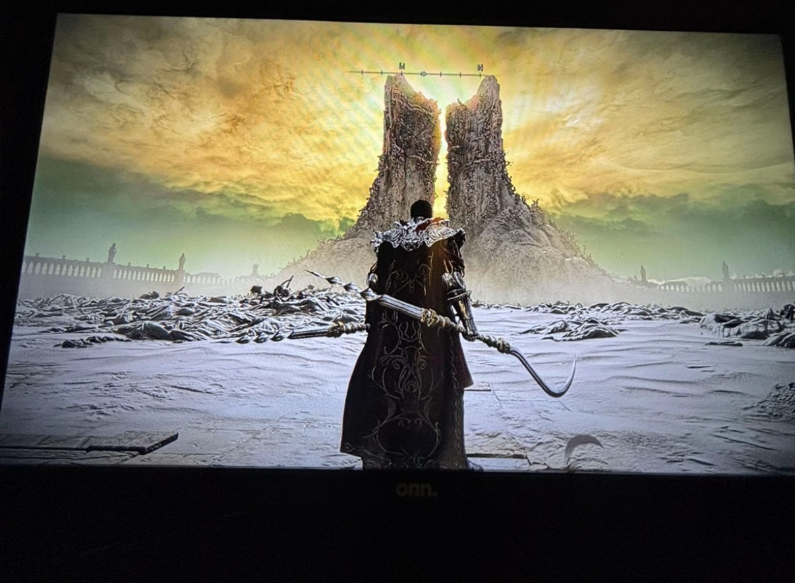
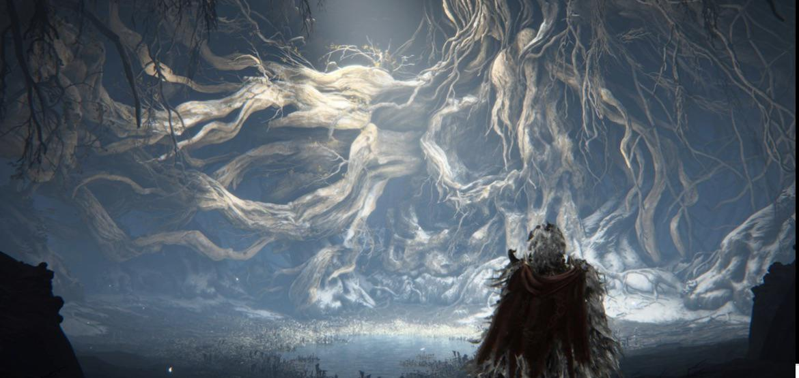
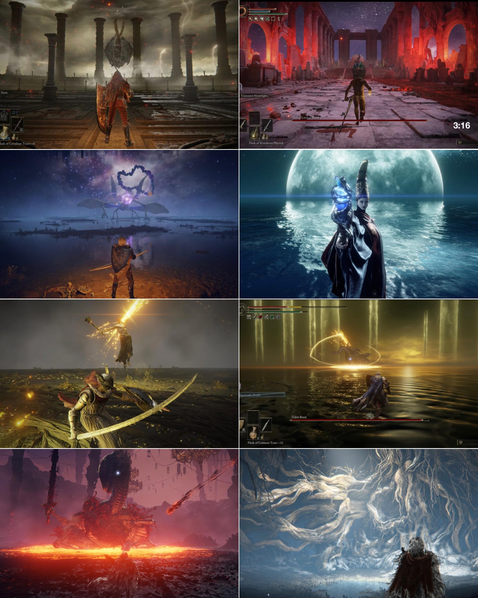
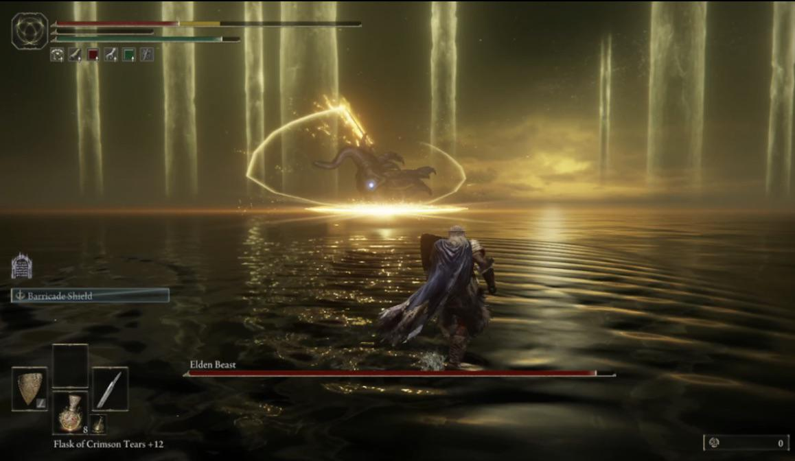
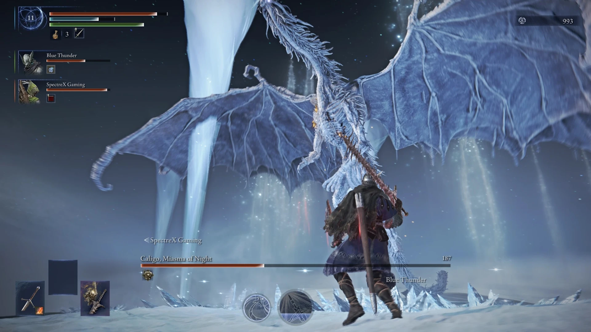
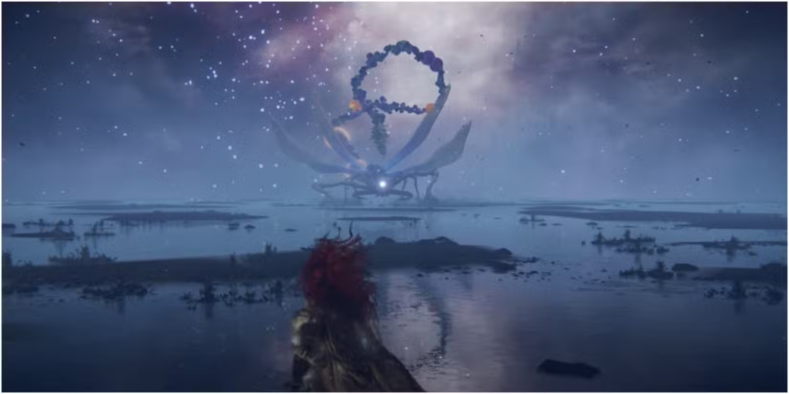
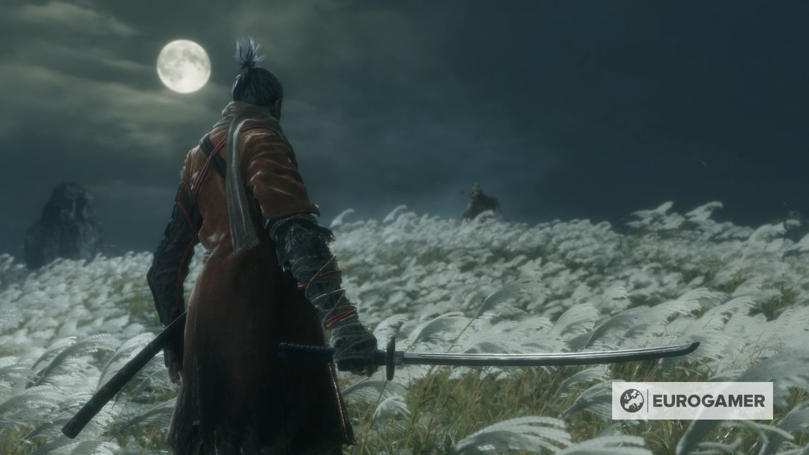
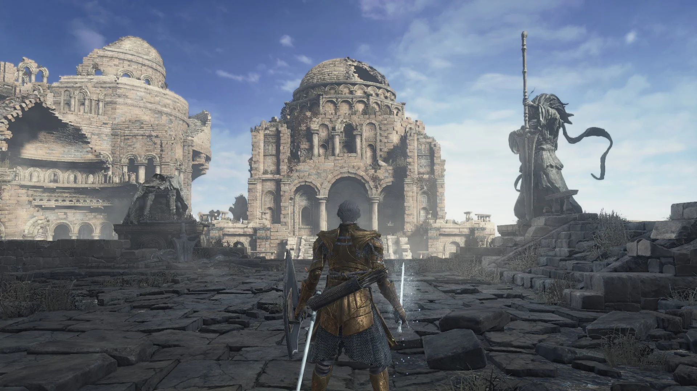
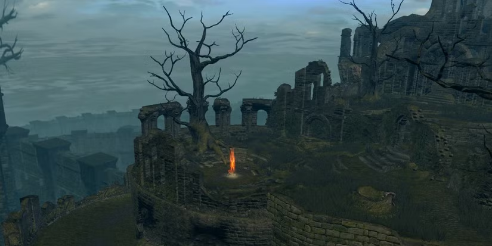

# Art direction from the creator’s references

Updated 7 November 2026. Read [ASSET_WORKFLOW.md](ASSET_WORKFLOW.md) for ForgeGUI reuse/generation and Blender production. The nine supplied images are the creative brief. They are reference screenshots, not precise dimension surveys or reusable game geometry. Build original spaces with comparable depth, gravity and staging; the plan is not a reconstruction of a particular existing game location.

The strongest shared qualities are a long readable approach, an enormous landmark, a small player silhouette against it, restrained materials, a clear combat floor, and several layers of distance. A larger flat rectangle surrounded by evenly spaced props will still feel like a test arena. So will a highly detailed miniature courtyard with no view beyond its walls.

## What each reference contributes

| Reference | Design lesson | Integration in Asura’s Path |
|---|---|---|
| R01 · ash and split monument | A single dominant vertical cleft, vast pale floor and dark accumulated edge detail make scale readable immediately. | Shen’s **Ashen Covenant** amphitheatre; an original split cenotaph and layered ruined arcades, not an imitation of the screenshot’s exact landmark. |
| R02 · root cathedral | Organic architecture grows out of load-bearing masses; large branching roots create a cathedral-scale silhouette. | Titan’s **Cathedral Beneath the Roots**; hero root buttress modules around a constructed burial hall and open fighting core. |
| R03 · arena moodboard | Distinct encounter palettes and staging: colonnades, ritual red, reflected stars, ash, roots. Each has a clear visual idea. | Give six arenas six identities; use bloodflame as a phase accent for Wu, a wide ascetic duel stage for Shen, and distant arcades for Twins. Do not paste all effects into every region. |
| R04 · gold over dark water | A low horizon and sparse distant verticals make a finite combat surface feel part of an immense world. | Wu’s **Starless Mirror Court**, with a reliable floor under a shallow visual water layer and authored boundaries. Keep the existing violet/crimson Oracle identity rather than making every object gold. |
| R05 · storm dragon space | Open overhead volume and a calm high-contrast floor let a large winged body read at close range. | Wyrm’s **Storm-Crowned Expanse**. Use actual imported wingspan/flight poses to size air and landing clearance. No new dragon model. |
| R06 · celestial water plain | Sparse foreground/midground props and a deep reflected horizon create mystery without clutter. | Wu’s distant skyline and subdued star reflections; keep telegraph visibility and a visible return route. |
| R07 · silver grass field | Wind, simple terrain, white foliage and a remote opponent create scale through living motion and restraint. | Baize’s frost-grass margins and distant ridge, with a dark central surface to keep the white beast readable. Sparse silver reeds may also edge Shen’s ash bowl. |
| R08 · layered domed ruins | Architectural hierarchy: foreground fragments, large occupied middle distance, taller distant skyline and consistent masonry construction. | The older processional precinct of the Twins and distant ruined-city fragments at the summit. Romanesque/sepulchral domes can sit beneath later monastery additions. |
| R09 · ruined rest pocket | A sheltered small refuge, a clear light source and layered traversal communicate history and safety. | Keep the approved Cloister rest shelter; improve nearby ruin construction and optional exploration pockets without erasing their intimate scale. |

## A coherent world that is not all wuxia

Keep the Sanctuary’s established East Asian sacred architecture and living bamboo. The wider world can reveal older civilizations: sepulchral stone courts, broken domed observatories, funerary arcades, root-bound crypts and storm-battered citadels. Connect them through consistent stone scale, geology, aged bronze, restrained ceremonial cloth, sediment/root growth and believable construction joins. Avoid a generic asset collage where each wall comes from a different visual scale or era without a transition.

Use three main construction languages deliberately:

1. **Living sanctuary / later monastery:** fitted timber, lacquer, bronze, carved stone and bamboo; preserve the existing good assets.
2. **Older buried empire:** heavy limestone/basalt, true arches, domes, processional stairs, funerary sculpture, worn inscriptions. This carries Twins, Crypt, Ash and portions of Pagoda/Citadel.
3. **Landscape reclaiming architecture:** roots, ash, frost, flooded courts and storm erosion. Place these according to exposure, water flow, collapse and support rather than randomized noise.

Damage should tell how the structure failed: a fallen bell has a split lip and impact debris, a dome has a coherent missing sector, a snapped rafter has exposed grain, a sunken court has a waterline, and a pillar transmits weight into a base. Fine cracks and scratches do not compensate for an unconvincing large form.

## Composition contract for every enlarged arena

- **Foreground:** a short entry frame or edge that makes the reveal work without blocking the normal camera. Tactile detail is concentrated here.
- **Combat middle ground:** materially larger playable ground with a readable opponent, feet, telegraphs and camera retreat space. Keep most height changes and clutter outside the primary exchange lanes.
- **Distant focal structure:** one dominant shape, then a quieter skyline. The backdrop can imply much greater scale than the fight area without requiring thousands of detailed objects.
- **Entry/exit/service pockets:** intentional route and rest spaces, not leftover strips between large floors. They must remain navigable and belong to the correct encounter/region volumes.
- **Light:** retain shadow and atmosphere but show route edges and silhouettes. Calibrate ordinary, combat and unbound profiles separately; fear comes from shape, scale and staging, not crushed-black exposure.
- **Camera:** prove the scene at the default FOV and player height. Ultra-wide concept art or a high aerial camera cannot substitute for the player view.

## Material and motion guide

| Family | Base material direction | Contrast and usage |
|---|---|---|
| Limestone | cool grey / warm mineral-grey with dark protected recesses | Large stable surfaces; avoid noisy, uniform salt-and-pepper textures. |
| Basalt / slate | charcoal, blue-grey mineral seams, broad wear | Ground the Wyrm and ash structures; do not crush all dark values to black. |
| Bronze | dark oxidized bronze, limited worn warm edges | Accents and load-bearing fittings, not bright gold paint over every object. |
| Petrified roots | mineral-ivory outer mass, umber/grey crevices | Titan foreground/overhead shape; keep clear branching gaps and thick supports. |
| Timber / lacquer | aged grain, dark desaturated reds/violet where regional | Match existing assets and joinery; keep garment/wood texel scale plausible. |
| Water / frost / grass | subdued reflections, broken wet edges, sparse motion | Rendered and budgeted as effects/foliage; separate from collision and attack effects. |

Foliage motion should communicate wind in a few clear layers. Do not attach an update connection to every blade. Water should not introduce swimming or buoyancy into a boss fight by accident. Emissive effects belong to authored cues and limited landmarks; they are not a substitute for physical form or route lighting.

## Tool choice and budgets

Inspect project/supplied assets and search the connected ForgeGUI account library, public catalog and past jobs before creating any component. Reuse suitable existing models and match their scale, materials and damage to the scene. Use ForgeGUI for genuinely missing decorative/sculptural assets. Blender handles precise repetitive construction—arches, domes, seats, frames, chains and openings—and production cleanup, retopology, baking, UVs and rig fitting. All nine approved H-sources already exist; preserve their designs and derive game versions instead of regenerating them. The creator judges concrete in-game visual comparisons. This division preserves coherent architecture while benefiting from stronger sculptural assets.

Build reusable modules, share mesh/material asset IDs and keep distant geometry coarse. Roblox documents instancing of matching meshes/material characteristics in its [performance guidance](https://create.roblox.com/docs/performance-optimization/improve). This makes modular reuse a sound strategy; it does not certify this project’s actual frame time. Measure foreground traversal and fighting on comparable workloads.

The captured project has streaming disabled. A streaming migration would change client instance availability and require its own lifecycle/replication tests; do not bundle it silently into an art pass. See the official [streaming documentation](https://create.roblox.com/docs/workspace/streaming). Use the existing landscape/effects budgets first and profile any proposed change.

## Supplied references

